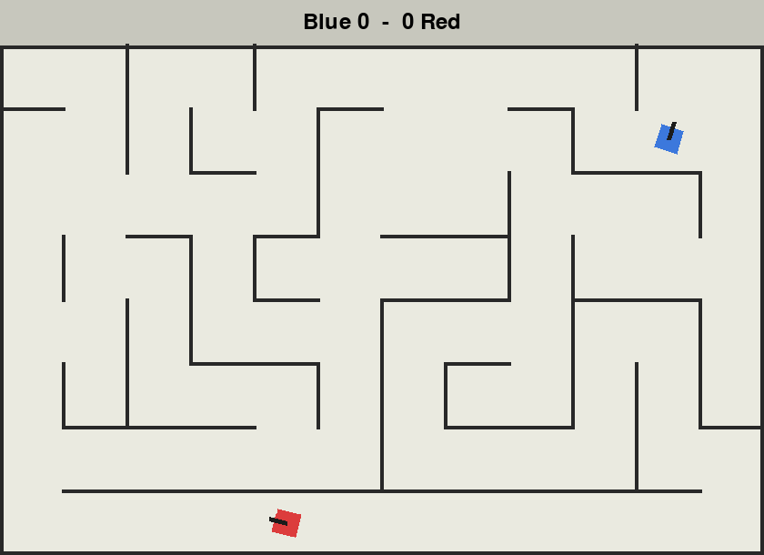
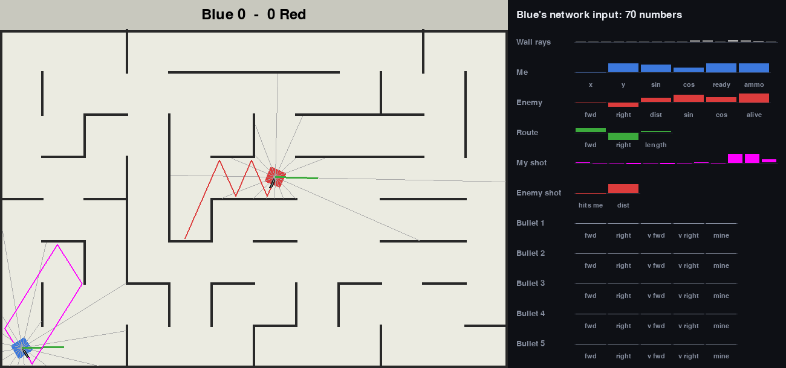
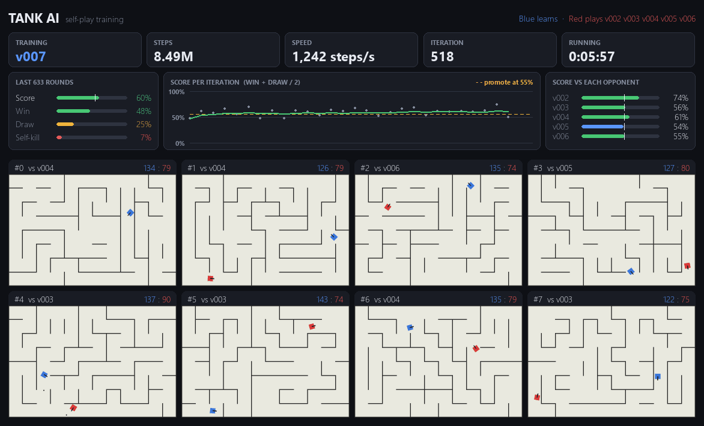

<div align="center">

# Tank AI

**Two tanks. A random maze. Bullets that bounce.**<br>
**One of them is teaching itself to play.**


[](LICENSE)



[Why it's hard](#why-its-hard) · [What it sees](#what-it-sees) · [Training](#training-against-itself) · [Rewards](#rewards) · [Progress](#progress) · [Play](#play-against-it)

</div>

## Try it live

The AI is online. Play against it in your browser, nothing to install.


  <a href="https://waffle639.github.io/Tank-AI/">
    
  </a>

## Overview

I made a small tank game, and then an AI that learns it from zero.

I never told it how to play. No tips, no strategy, no "if the enemy is close, shoot". The only thing it ever hears is whether it **won or lost** the round. From that alone, over millions of decisions and tens of thousands of rounds, it has to work out everything else.

That's **Reinforcement Learning**: learning by trial and error from a reward. To keep it improving, it trains against the toughest opponents available: its own past versions.

## Why it's hard

It sounds simple. It isn't:

- **Its own bullets kill it.** Firing at random is suicide, so it has to learn when *not* to shoot.
- **Bullets bounce.** The best shot is often off a wall, and so is the one that comes back at you.
- **The maze is new every round.** It can't memorize a map. It has to learn skills that work anywhere.
- **It only hears the result.** "You won" arrives seconds after the decisions that actually won it. Working out *which* decisions those were is the heart of the problem.
- **Its opponent is itself.** Every time it gets better, so does the enemy.

How hard? The first version, playing against a tank that **doesn't even move**, killed itself in 43% of its rounds.

## What it sees

The AI never looks at the screen. Fifteen times a second it gets a list of **70 numbers** and answers by pressing 5 buttons: forward, back, left, right, shoot.

<div align="center">

</div>
<br>

| About | It knows |
|---|---|
| **Its surroundings** | how far the nearest wall is, in 16 directions |
| **Itself** | where it is, which way it faces, whether it can shoot |
| **The enemy** | where it is, which way it's aiming, whether it's alive |
| **The way there** | which way to go through the maze to reach the enemy |
| **Its own shot** | where a bullet fired *right now* would bounce, and whether it would hit the enemy or itself |
| **The enemy's shot** | whether the enemy could hit it right now |
| **Flying bullets** | the 5 closest ones: where they are, how fast they go, and whose they are |

Two of these are a deliberate shortcut. **The way through the maze** and **where a shot would bounce** are worked out by my code, not learned. I give it senses, not strategy: it still has to decide where to go, when to shoot and when to back off. I added them after my first agent kept driving into walls.

<details>
<summary><b>Technical details</b></summary>
<br>

- Everything is **relative to the tank**: "40 px ahead and 12 px to the right", not map coordinates. The same situation looks the same anywhere on the map, and a model trained as Blue can play as Red.
- Everything is **scaled into [-1, 1]**, and angles are given as sin and cos so that 359° and 1° look alike.
- The route is a breadth-first search over the maze cells. The shot is a ray traced through up to 4 bounces.
- The game runs at 60 fps and the AI decides every 4 frames, holding its buttons in between.
- The brain is two small neural networks (two hidden layers of 256 each): one picks the buttons, the other estimates how good the situation is.

</details>

## Training against itself

The AI improves by playing against frozen copies of its past selves. This is called **self-play**.

<div align="center">

</div>
<br>

Only Blue learns, with **PPO** (Proximal Policy Optimization, from Stable-Baselines3). It plays 8 games at once, and after each batch it makes the moves that turned out *better than expected* a little more likely. The steps are small on purpose, so one lucky batch can't undo what it already knew, and a small bonus for staying a bit random keeps it exploring.

Red is one of Blue's **last 5 versions**, picked at random every round. Facing many opponents at once matters: if it only played its newest copy, it would overfit to that one opponent's habits and forget how to beat the older ones, getting stuck in a rock-paper-scissors loop. Mixing in past versions keeps the old lessons alive.

Every 10 updates, Blue is checked against each of them. Once it scores **55% or more against every one**, it's frozen as the next version and joins the opponents. At the very beginning there are no versions yet, so the first opponent is a tank that just stands still.

- **55%, not 50%.** A Blue that's only as good as its rivals could reach 50% by luck. 55% needs a real edge.
- **Against each one, not on average.** Otherwise "crushes the old versions, loses to the newest" would pass.

## Rewards

The reward is the only feedback it gets, so it's kept small and hard to game:

| Event | Reward |
|---|:---:|
| Win | **+1**, up to **+2** if it's fast |
| Loss, self-kill, or both tanks dead | **−1** |
| Getting closer to the enemy through the maze | up to **+0.5** per round |
| Firing a shot that will hit the enemy | **+0.3**, once per round |
| Firing a shot that will hit itself | **−0.3** |

The result is what matters. The small rewards only help at the start, and none can be farmed: driving back and forth earns nothing, and spraying bullets only pays once. There's no penalty for time, because it would make an early self-kill cheaper than playing on.

### What went wrong on the way

| Problem | Fix |
|---|---|
| It stopped shooting: self-kills went to 0%, and every round hit the time limit | Gave it the route and the shot prediction, and rewards for good and bad shots |
| Dying together paid off: draws rose to ~47%, wins fell from 49% to 33% | Both tanks dead is now a plain loss |
| Promotions were too easy: four versions in 3 minutes | It must beat *each* opponent, not the average |
| Then none at all: stuck on v002 for over an hour, with ~45% draws | A draw counts as half a win |
| It became predictable: entropy fell from 3.5 to 0.55 | A small bonus for keeping some randomness |
| The network seemed too small (two layers of 64) | Two layers of 256, trained again from zero |

## Progress

Every version is logged with how it played when it was frozen. The **score** is wins + half the draws.

| Version | Trained against | Wins | Draws | Self-kills | Score |
|:---:|:---|:---:|:---:|:---:|:---:|
| v001 | a tank that stands still | 56% | 34% | 43% | **73%** |
| v002 | v001 | 34% | 43% | 19% | **56%** |
| v003 | v001 – v002 | 36% | 42% | 11% | **57%** |
| v004 | v001 – v003 | 37% | 41% | 11% | **57%** |
| v005 | v001 – v004 | 46% | 32% | 11% | **62%** |
| v006 | v001 – v005 | 48% | 30% | 9% | **63%** |

<sub>As of 17 Nov 2026.</sub>

- **It learned to respect its own bullets.** Self-kills went from 43% to 9%.
- **Steady scores are good news.** The opponents get stronger every time, so scoring 56–63% again and again means every version beats all the ones before it.
- **Wins are climbing, draws are falling.** Since v002, wins went from 34% to 48% and draws from 43% to 30%, but about 1 round in 3 still ends with both tanks dead.

<details>
<summary><b>Under the hood</b></summary>
<br>

Everything runs on the **CPU**. The network is small and is only ever asked about 8 games at a time, so most of the work is simulating the game itself.

- **The game never draws while training.** All the rules live in `tank_game/game.py`, and drawing is a separate step, done only when someone is watching.
- **Fewer collision checks.** Walls are pre-filtered in C (pygame's `collidelistall`), and all 16 rays are cast against every wall at once with numpy. Together these made the game about **3.7× faster** to simulate.
- **The right number of threads.** While the games play, the network uses 1 thread, because more only fought the games for the CPU (about 30% slower). While it learns, the games wait, so it takes every core (3.0 s → 2.1 s per update).

```
tank_game/   the game: rules, physics, maze and drawing
rl/          what the AI sees, its rewards, the training environment and the training window
train.py     self-play training
main.py      play: you against the AI, or two humans
models/      the saved versions, for training (.zip) and for the browser (.onnx)
web/         the browser version: the game in JavaScript (src/), its build (scripts/) and its tests (test/)
```

```bash
python train.py                # trains, and continues where it left off
tensorboard --logdir runs      # every stat over time
```

</details>

## Play against it

**[Play it in your browser](https://waffle639.github.io/Tank-AI/)**, nothing to install. Pick any version as your opponent and watch its neural network think while it hunts you, or play with a friend on one keyboard.

You play **Blue**. The AI plays **Red**.

| Move | Turn | Shoot | See through its eyes |
|:---:|:---:|:---:|:---:|
| W / S | A / D | Space | **F1** |

In the browser the arrows work too, Esc pauses and M mutes. On your machine, R draws a new map.

It's still learning. It will find you through the maze and shoot off the walls, but it still blows itself up in about 1 round out of 10.

To run it on your machine instead:

```bash
git clone https://github.com/Waffle639/Tank-AI.git
cd Tank-AI
pip install -r requirements.txt
python main.py models
```

<details>
<summary><b>How the browser version works</b></summary>
<br>

The AI was trained in Python with PyTorch, but nobody should have to install PyTorch to play. So the page runs its own copy of everything, with no server:

- **The network goes out as ONNX**, the standard format for running a trained model outside the library that trained it. Only the part that picks the buttons is exported: 85,253 numbers in a 341 KB file, instead of the 2 MB training checkpoint, which also holds the network that judges positions and the optimizer's state. The browser runs it with ONNX Runtime Web.
- **You can watch it think.** The file also gives out what its two hidden layers compute, which adds no weights. The panel next to the map shows one decision from the inside, 15 times a second: the 70 numbers it sees, its 512 neurons, and how likely it is to press each button.
- **The game is ported to JavaScript.** That makes two copies of the same game, and they must agree: the network only plays well if it gets exactly the 70 numbers it saw in training. So the Python game records moments from real games, hunting for every kind of event (a shot, a bounce, a tank pushed off a wall, a death, the end of a round), and a test checks that the JavaScript computes the same numbers, the same next frame and the same button probabilities. Another set of tests plays the page itself in Chromium, Firefox and WebKit. All of them run on every push, and the site is only published if they pass.
- **Nothing runs anywhere else.** No input lag and nothing to keep switched on. The heaviest part is the ONNX runtime (14.8 MB before compression), so it loads while you're still in the menu, and the 2-player mode doesn't wait for it.

</details>

--- 
Any help or feedback is welcome. 🙌
